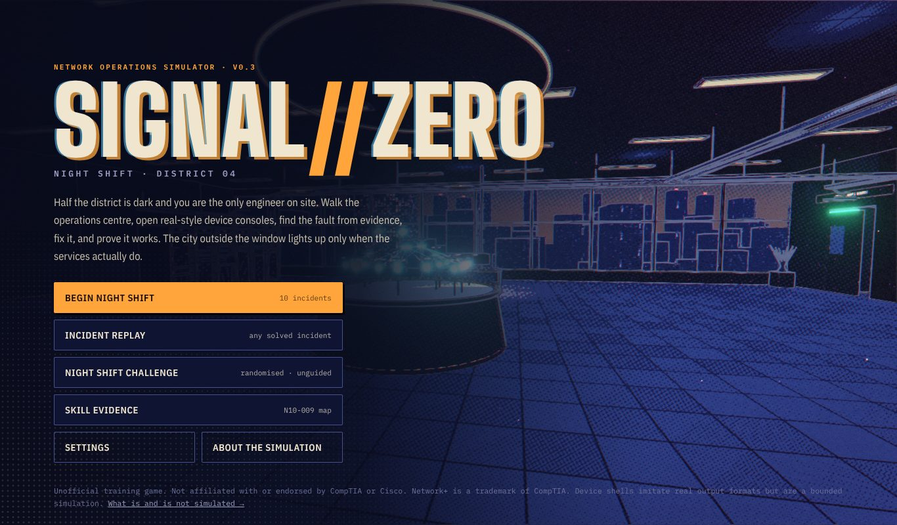
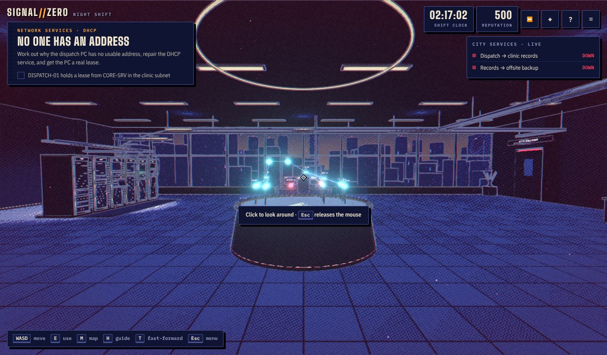
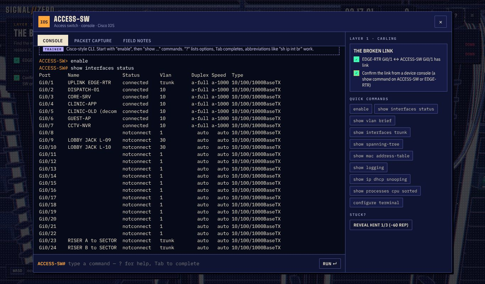
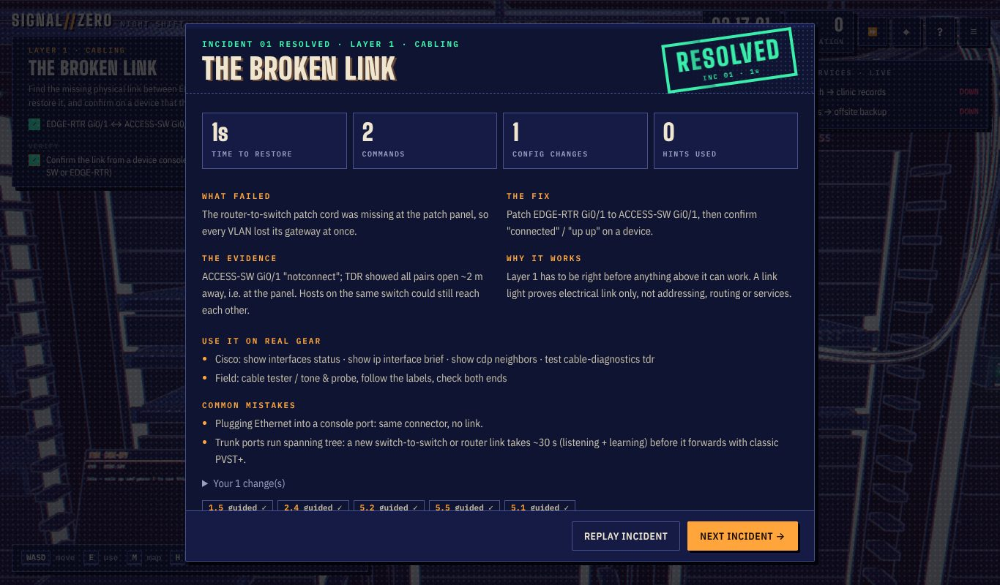
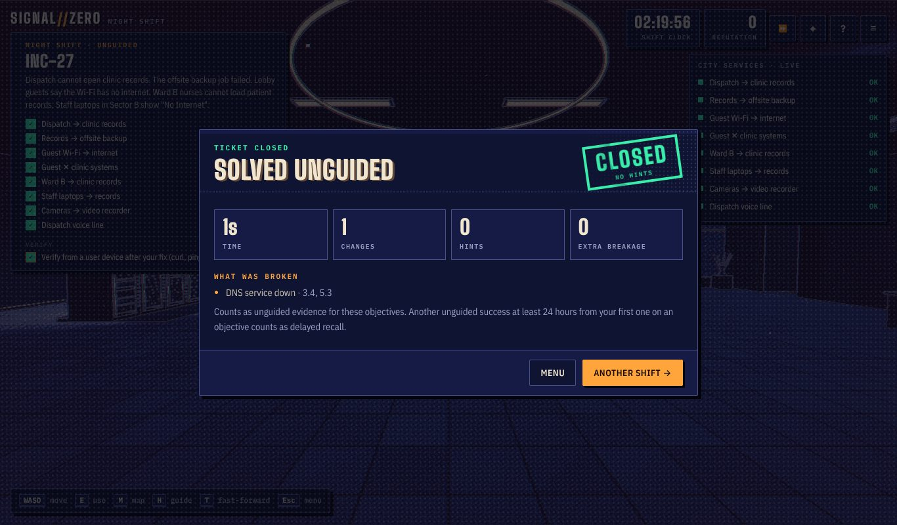
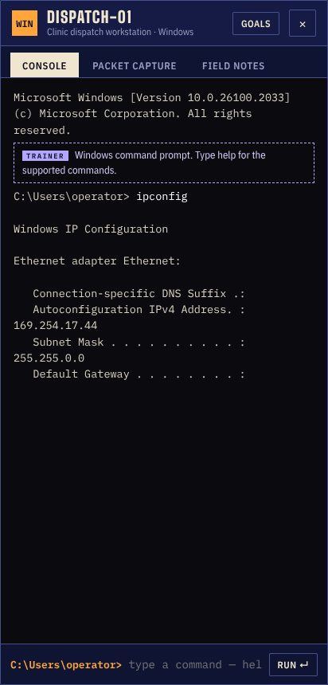

# SIGNAL//ZERO — Night Shift

A first-person network operations game. You are the only engineer on site at 02:17, half the district is dark, and every fix has to be found from evidence, made on real-style device consoles, and proven from where users are. The city outside the window lights up only when the services actually work.

**Version 0.3** (15 October 2026). Supersedes the v0.2 prototype, which is preserved unchanged in [`prototype/v0.2/`](prototype/v0.2/).

## Play

**[Play SIGNAL//ZERO live](https://robvanprod.github.io/SignalZero/)** — no download or installation required.

GitHub Pages automatically builds and deploys the latest source when changes are pushed to the default branch (`ccr-4b891939-1lgafn`). The deployment can also be started manually from the repository's **Actions → Deploy game to GitHub Pages** workflow.

To build and play offline:

```bash
npm install
npm run build           # -> dist/signal-zero.html (single file, works offline)
```

Open `dist/signal-zero.html` in a current Chrome, Edge, Firefox or Safari. If your browser blocks local files, serve the folder (`npx serve dist`) and open the printed URL. WebGL 2 is required. Three.js is bundled, so no network access is needed at runtime.

- **Desktop:** click to capture the mouse, `WASD` move, `E` use, `M` map / IPAM / quick travel, `H` field guide, `T` fast-forward time ×8 (for STP timers and DHCP renewals), `Esc` close / menu.
- **Touch:** left stick to move, drag the right side to look, `USE`, `MAP`, `MENU`.
- Graphics quality (Low / Medium / High) is auto-detected; change it in Settings or with `?q=low|medium|high`.

## What the game is

| Mode | What it trains |
|---|---|
| **Apprenticeship · Lesson 1: Next hop** (start here; a 2D bench, not the 3D world) | How a host decides where to send a packet: address and prefix length, ARP for the next hop, the default gateway, the return path. It shows a working network first, then guided use, a changed example, one fault, and an unguided case. Outputs are compared with the same network built from real Linux kernels. See [`docs/apprenticeship/`](docs/apprenticeship/). |
| **Night shift campaign** (10 incidents, one persistent network; incidents 1–4 come with a step-by-step coach) | Guided: physical patching, DHCP service failure, stale DNS + client cache, uninstalled default route, VLAN + ACL segmentation, broadcast storm with an aftershock, DHCP relay, subnet re-planning for 50 cameras, duplex mismatch vs voice quality, rogue DHCP. |
| **Incident replay** | Any solved incident from a clean copy of the network at that point. |
| **Night Shift challenge** | Unguided: randomised addressing and VLAN IDs, 1–2 injected faults from a library of 15, a symptom-only trouble ticket, no trainer notes. The generator proves each challenge is solvable before handing it out. |
| **Skill evidence** | Per N10-009 objective: guided → unguided → delayed (≥24 h later) → transfer (self-reported). |

Design rules carried over from the v0.2 plan:

- **Coach, then fade.** Incidents 1–4 are broken into small steps. Each step says what to do and where, an orange marker points at the place, and the coach explains each result as it appears. Steps are detected from what you actually did and never block a correct fix. From incident 5 on, only hints remain; challenges have neither.
- **No quiz gates.** Win conditions are behavioural checks against the simulator ("does Ward B's HTTPS request to the records app actually succeed?"), never "did you type this exact line". Any correct fix passes; a "fix" that breaks another service fails the constraints.
- **Fix, then verify.** An incident completes only after the player produces evidence from a user-facing test *after* the fix (e.g. `curl` from the affected PC).
- **Several valid interventions with measurable trade-offs.** In the broadcast storm, Rapid PVST+, PVST+ and "shut a riser" all stop the storm; a scripted riser cut later measures the outage each choice causes (≈1–2 s with Rapid PVST+ on both switches, ≈30 s with PVST+ or a mixed pair, or until a human reacts). In the rogue DHCP incident, shutting the port contains it; DHCP snooping prevents the repeat.

## Look: "Night Ink"

The world is drawn as an ink illustration printed in a few flat inks, and **only live signal glows**: link LEDs, packets, screens, and the windows of districts whose services work. Fixing the network puts the light back. Every glow means something, so state can be read from the scene. Outlines come from the depth buffer, tones are halftoned between five ink bands, and the UI is set as printed work orders in condensed civic type. Rules and implementation: [`docs/ART_DIRECTION.md`](docs/ART_DIRECTION.md).








## How it is built

```
src/engine/     deterministic network engine (no DOM): L1 negotiation, 802.1Q, PVST+/RSTP, routing, ACLs, PAT,
                DHCP/DNS/HTTPS services, packet path tracing, simulated clock
src/cli/        device shells: Cisco IOS-style (modes, abbreviations, ?, Tab), Windows cmd, Ubuntu shell
src/content/    the district topology, 10 missions, challenge generator + fault library, N10-009 map
src/game/       campaign/challenge runtime, skill evidence, local playtest telemetry, app controller, audio
src/world/      Three.js world: rooms, racks, cables routed through trays, packet particles, holo table, city;
                Night Ink pipeline (style.js: toon materials, ink/halftone pass, print pass)
src/ui/         HUD, consoles, nano editor, patch panel, packet capture, map/IPAM, menus
tests/unit/     node:test suites (engine, parsers, CLI grammar, all missions, generator property tests)
tests/browser/  end-to-end test in Chromium with real WebGL (SwiftShader), writes screenshots
docs/           simulation model, curriculum map, QA status and the next falsifiable step
```

```bash
npm test                # unit + mission + generator tests (node:test)
npm run test:browser    # needs `npm run build` first; real WebGL via SwiftShader; screenshots -> tests/browser/out/
npm run test:lesson     # Lesson 1 played through the real UI (desktop and phone); needs `npm run build` first
node scripts/lab-compare.mjs   # simulator vs the real-kernel lab in docs/apprenticeship/lab (also part of npm test)
```

## Honest status

- Simulation, missions and generator: covered by automated tests (see [`docs/QA_AND_NEXT_ITERATION.md`](docs/QA_AND_NEXT_ITERATION.md)).
- Rendering: exercised in headless Chromium with a software WebGL 2 implementation, not on real GPUs or phones. Frame rate on real devices is unmeasured. Whether the art style helps or hinders reading the network over a full shift is untested.
- Learning: **not yet tested with learners.** Nothing here shows that players enjoy it, learn from it, or transfer skills. The next decision gate is the Lesson 1 playtest ([`docs/apprenticeship/PLAYTEST.md`](docs/apprenticeship/PLAYTEST.md)); no further lessons until it shows the lesson closes the gap.
- Realism of Lesson 1: 110 of 111 lab commands print the same as real iproute2/iputils, and all 10 frame captures match ([`docs/apprenticeship/VALIDATION.md`](docs/apprenticeship/VALIDATION.md)). Windows and Cisco IOS outputs elsewhere in the game have not been compared with real devices.
- Scope: a subset of N10-009 ([`docs/CURRICULUM.md`](docs/CURRICULUM.md)). Not an exam-prep substitute.

Unofficial. Not affiliated with or endorsed by CompTIA or Cisco. Network+ is a trademark of CompTIA. Addresses use RFC 1918 and documentation ranges (198.51.100.0/24, 203.0.113.0/24); domains use `.example`. Third-party licences (three.js MIT; fonts SIL OFL 1.1): [`docs/THIRD_PARTY.md`](docs/THIRD_PARTY.md).
